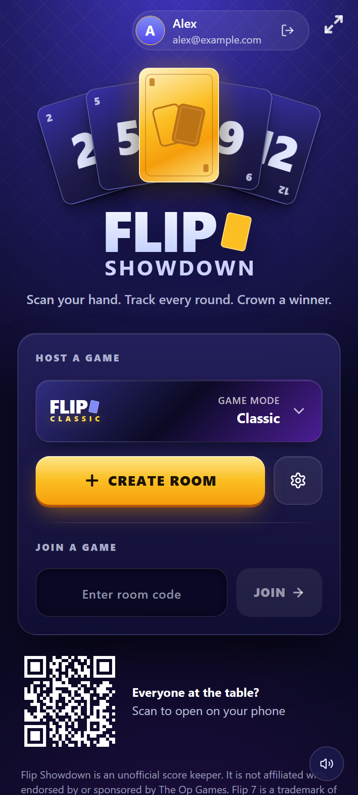
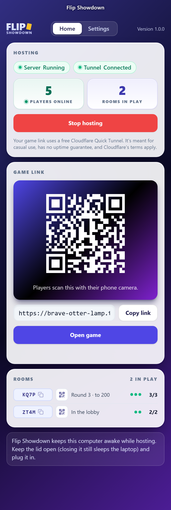
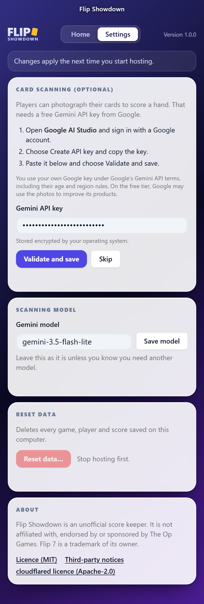
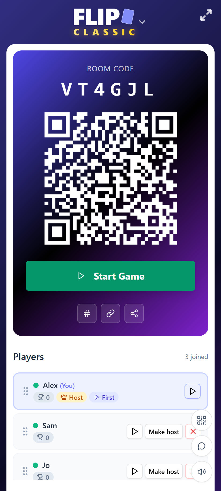
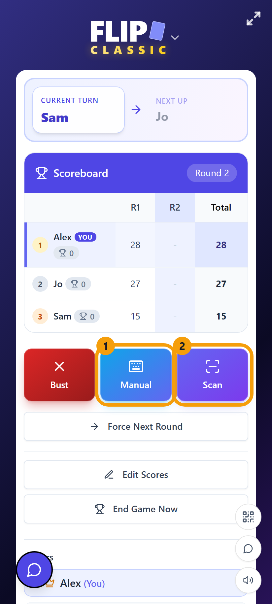
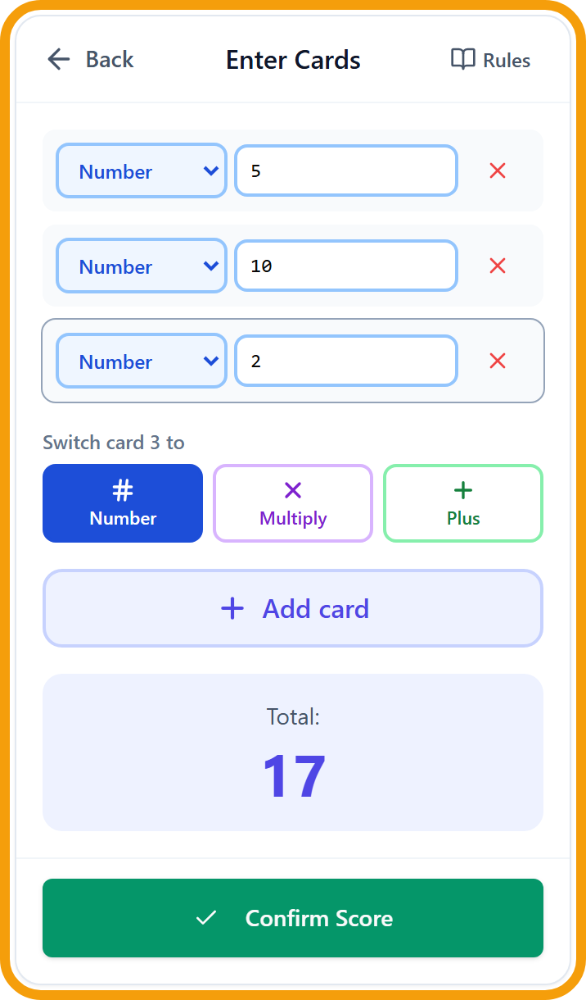
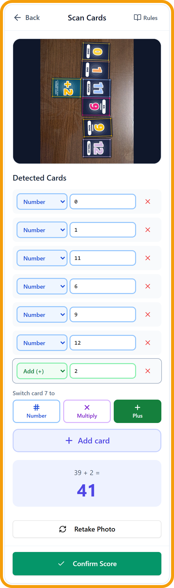

# Flip Showdown

> Flip Showdown is an unofficial score keeper. It is not affiliated with, endorsed by or sponsored by The Op
> Games. Flip 7 is a trademark of its owner.

Score-keeping app for the card game Flip 7: players join a room from their phones and
scores update live for everyone.

It runs on a small self-hosted Node backend in
`server/` (see `docs/backend-contract.md` for the API). The frontend talks to it through
`src/api/backend.js` for auth, reads and subscriptions. Game writes go through the server's
game actions (see below).

<p align="center">
  
</p>

## Desktop launcher

An app that hosts the game from your computer with no Docker, Node or npm: press **Start
hosting**, and players scan the QR code it shows. The game opens in your browser; the launcher
is just the control panel. Decisions behind it are in [docs/decisions.md](docs/decisions.md) (X61).

| Hosting a game                                                                                                                                                                                 | Settings                                                                                                                                                                |
| ---------------------------------------------------------------------------------------------------------------------------------------------------------------------------------------------- | ----------------------------------------------------------------------------------------------------------------------------------------------------------------------- |
|  |  |

The window has two tabs:

- **Home** starts and stops hosting. While it hosts, it shows whether the server and the tunnel
  are up, how many players are online and in how many rooms, the QR code and link players open on
  their phones (**Copy link**, or **Open game** to play from this computer too), and each room in
  play with its code, round and who is online. A room's QR icon shows an invite code for just that
  room.
- **Settings** holds the optional Gemini key for card scanning (see
  [AI card scanning](#ai-card-scanning-free-api-key) below), the scanning model, and **Reset
  data**.

The launcher checks GitHub for a newer release and shows a banner when there is one.

1. Download the latest version for your system:
   
   | Windows                                                                                                                            | macOS                                                                                                                    | Linux                                                                                                                              |
   | ---------------------------------------------------------------------------------------------------------------------------------- | ------------------------------------------------------------------------------------------------------------------------ | ---------------------------------------------------------------------------------------------------------------------------------- |
   | [⬇ Download for Windows (.exe)](https://github.com/ruttyj/FlipShowdown/releases/latest/download/Flip-Showdown-Setup-Windows.exe) | [⬇ Download for macOS (.dmg)](https://github.com/ruttyj/FlipShowdown/releases/latest/download/Flip-Showdown-macOS.dmg) | [⬇ Download for Linux (.AppImage)](https://github.com/ruttyj/FlipShowdown/releases/latest/download/Flip-Showdown-Linux.AppImage) |
   
   Open the download: the Windows installer sets the app up in one click and starts it, the macOS
   disk image lets you drag it to Applications, and the Linux AppImage is the app itself (make it
   executable first, see below). Older versions are on the
   [Releases](https://github.com/ruttyj/FlipShowdown/releases) page.

2. The builds aren't signed, so the first run shows a warning:
   
   - **Windows**: SmartScreen says "Windows protected your PC". Click **More info**, then **Run anyway**.
   - **macOS**: right-click the app in Applications and choose **Open**, then **Open** again (on newer
     macOS: System Settings → Privacy & Security → **Open Anyway**). If macOS says the app "is damaged",
     run `xattr -dr com.apple.quarantine "/Applications/Flip Showdown.app"`.
   - **Linux**: `chmod +x Flip-Showdown-*.AppImage`, then run it.

3. Optional: under **Settings**, paste a free Gemini API key to turn on card scanning (see
   [AI card scanning](#ai-card-scanning-free-api-key)). Without one, players enter cards by hand.

4. Press **Start hosting**. Keep the lid open and the laptop plugged in: the launcher stops the
   computer sleeping while it hosts, but closing the lid can still suspend it, and it warns while
   on battery. If the tunnel drops, it reconnects by itself and shows "URL changed, rescan"
   when the link is new. Your game link uses a free Cloudflare Quick Tunnel. It's meant for
   casual use, has no uptime guarantee, and Cloudflare's terms apply (the same goes for
   `npm run share`).

Quitting while hosting asks "Stop hosting and quit?", and the public link dies with it. Games and
settings stay on your computer, under the app's data folder: `%APPDATA%\Flip Showdown` (Windows),
`~/Library/Application Support/Flip Showdown` (macOS), `~/.config/Flip Showdown` (Linux).
The Gemini key is stored encrypted by your operating system (Windows DPAPI, the macOS Keychain or
the Linux keyring); on Linux without a keyring it is stored unencrypted, and Settings says so.
**Settings → Reset data** deletes the games. As with `npm run share`, anyone with the link can
sign in while you host.

### What the host stores

Everything stays on the hosting computer: players' names, the emails they sign in with, chat,
scores and the game's event log. Card photos leave it only when scanning is on, and then go to
Google's Gemini API under your own key (on the free tier Google may use them to improve its
products). **Reset data** deletes the games. Anyone with the game link can sign in, so you decide
who gets it, and you are responsible for who you share it with.

The licences are in [LICENSE](LICENSE) (MIT) and, for the open-source packages the app
includes, in `THIRD_PARTY_NOTICES.txt`, which the build generates and the app serves at
`/licenses`. The launcher's **Settings → About** opens both, and cloudflared's Apache-2.0 licence.

**For contributors.** `npm run desktop` builds the client and the launcher UI, fetches `cloudflared`,
stages the server and starts the launcher from source (its data goes under
`flip-showdown-desktop` instead). The fetch (`npm run fetch:cloudflared`) downloads the pinned,
checksum-checked `cloudflared` into `desktop/resources/cloudflared/` once and skips it after that. `npm --prefix desktop run dist` builds the client and launcher
UI, stages the server, fetches `cloudflared` and runs electron-builder into `desktop/out/`.
Pushing a `v*` tag that matches the root `package.json` version runs
`.github/workflows/release.yml`, which builds all three installers into a draft GitHub Release to
check and publish by hand. The run fails if the release stops being a draft before it ends, so
publish only once every job is green. The root `package.json` version is the app's version.

## Screenshots

| Lobby                                                                                                                           | Game in progress                                                                                                                              |
| ------------------------------------------------------------------------------------------------------------------------------- | --------------------------------------------------------------------------------------------------------------------------------------------- |
|  |  |

Each player enters their own score at the end of a round, with **Manual** (1) or **Scan** (2):

| 1. Manual input                                                                                                        | 2. Card scanner                                                                                                                     |
| ---------------------------------------------------------------------------------------------------------------------- | ----------------------------------------------------------------------------------------------------------------------------------- |
|  |  |

## AI card scanning (free API key)

With **Scan**, a player photographs their hand and Google's Gemini AI reads the cards and adds
up the score; the player checks the result and can fix any card before submitting. Scanning needs
a Gemini API key on the computer that hosts the game. Google gives these out for free, so nobody
pays anything to use it. Without a key everything else works and players use **Manual**.

**Get a key** (about two minutes, only the host needs one):

1. Open [Google AI Studio's API key page](https://aistudio.google.com/apikey) and sign in with
   any Google account. Accept the terms if it's your first visit.
2. Choose **Create API key**. If it asks for a project, pick the suggested one or create one.
3. Copy the key (a long string starting with `AIza`).

You don't need to add a payment method: a key without billing stays on Google's free tier, which
is rate-limited (a few scans per minute and a daily cap, plenty for a table of friends). If you
hit the limit, the scan fails with an error and the player can wait a moment or enter the cards
by hand. On the free tier Google may use what is sent to improve its products, so the photos of
the cards may be seen by Google; nothing else about the game is sent. Check
[Google's current limits and terms](https://ai.google.dev/gemini-api/docs/rate-limits) for the
exact numbers.

**Add the key:**

- **Desktop launcher**: **Settings → Card scanning**, paste the key and choose **Validate and
  save**. The launcher checks it with Google first and says whether it works; a key Google
  rejects isn't saved. **Skip** clears it and turns scanning off. The key is used from the next
  **Start hosting**.
- **`npm run share`**: it asks for the key the first time and saves it as `GEMINI_API_KEY` in
  `.env`. Press Enter to skip.
- **Any other setup**: set `GEMINI_API_KEY` in `.env` (or the server's environment) and restart.

The key stays on the hosting computer: phones send the photo to your server, and the server
calls Gemini, so players never see the key. Leave the scanning model (`gemini-3.5-flash-lite`)
as it is unless Google retires it; any Gemini model that reads images works.

Treat the key like a password: don't commit `.env` or share screenshots of it. If it leaks,
delete it in AI Studio and create a new one.

## How it works

- **The client scores hands and the server owns the rest of the rules.** Both import the rule
  kernel, `shared/rules.js`: what each mode allows and what a hand is worth. Joining, starting,
  submitting scores, advancing rounds, kicking, host changes and play-again are actions under `/api/rooms` (`src/api/game.js` on the
  client). Rounds advance on the server as soon as every player has submitted, so nothing
  depends on the host's phone being awake. Generic writes to GameRoom, Player and
  RoundScore are blocked by default (`LOCK_GAME_ENTITIES`).
- **Realtime is room-scoped.** A client only receives events for rooms it is a member of.
  The server tracks who is online (the offline badges next to players) and keeps a durable
  event log in SQLite, so after a reconnect or a server restart the client replays what it
  missed instead of reloading the page.
- **The client recovers by itself.** `src/api/roomChannel.js` puts a room right after a reconnect,
  and the wire vocabulary both sides use is in `shared/realtimeProtocol.js`. A banner shows when the connection is lost or the
  login has expired, and the room is refetched when the socket reconnects, the phone wakes
  or the page returns from the background. Failed writes show an error toast, and a score
  that didn't send stays in the scanner for a retry.
- **Choosing a new host is a hold-to-vote.** When the host is gone, everyone online holds
  the same player's button for 3 seconds. The vote passes when all of them agree (one
  voter is enough if the host is offline). Releasing early cancels it.
- **The screen stays on** with a wake lock, at some battery cost and with no setting for it.
  Where the browser doesn't offer one (plain HTTP), the screen locks as usual.
- **Chat can be muted** per device with the button above the sound toggle in a game room.
- **Room links** are `/room/CODE` (e.g. `/room/3Z7R7L`). Old `/GameRoom?code=CODE` links redirect there.

## Development

Prerequisites: Node 20+.

1. `npm run dev` starts both the backend (port 7001, restarted when `server/src` changes;
   see `server/` for its environment variables) and the Vite dev server.
   In the default `dev` auth mode there are no passwords: `/login` asks for an email and
   display name, so you can test several players from different browsers or incognito
   windows.

2. In the project root:
   
   ```sh
   npm install
   npm run dev
   ```
   
   The site runs at http://localhost:7000. Vite proxies `/api` (including the realtime
   WebSocket) and `/login` to `http://localhost:7001` (override with `API_URL`), and
   listens on all interfaces so phones on the same LAN can open the URL it prints.

Other scripts:

- `npm run build` — production build into `dist/` (served by the backend).
- `npm run lint` — ESLint.
- `npm run scan:secrets` — scans the git history and uncommitted files for leaked keys
  (Betterleaks, see `docs/testing.md`).
- `npm test` — client tests (`tests/`). Server tests: `cd server && npm test`. The full
  testing guide (UI tests, e2e, coverage) is in `docs/testing.md`.

## Docker

Prerequisites: Docker Desktop, and `npm install` once (the share script uses the `qrcode`
package).

| Command         | What it does                                                                                                                                                                                                                                                                                                                                                                                  |
| --------------- | --------------------------------------------------------------------------------------------------------------------------------------------------------------------------------------------------------------------------------------------------------------------------------------------------------------------------------------------------------------------------------------------- |
| `npm run share` | **The main way to run the app, and how players get on from their phones.** Asks for a Gemini API key if `.env` has none, starts the **dev server** (hot reload) plus a Cloudflare quick tunnel, and prints a QR code for the public `https://<random>.trycloudflare.com` URL. Ctrl+C doesn't reliably stop the tunnel, and the URL stays public while it runs, so finish with `npm run stop`. |
| `npm start`     | Builds and starts the production app at http://localhost:7007 (port from `HOST_PORT` in `.env`), on this computer only                                                                                                                                                                                                                                                                        |
| `npm run stop`  | Stops everything, including the tunnel                                                                                                                                                                                                                                                                                                                                                        |

`.env` is created from `.env.example` on the first `npm run share`. The dev server runs the
source folder directly: edits to `src/` hot-reload on every connected phone and edits to
`server/src/` or `shared/` restart the API. The first run installs dependencies into Docker volumes and
takes a few minutes.

Data lives in Docker volumes and survives rebuilds: `flip-showdown_app-data` for `npm start`,
`flip-showdown_dev-data` for `npm run share`.

AI card scanning uses Google Gemini through the server (`GEMINI_API_KEY`, default model
`GEMINI_MODEL`); the key never reaches the browser. See
[AI card scanning](#ai-card-scanning-free-api-key) for getting a free key.

When sharing, open the app on your computer through the public URL too, so the in-app room
invite QR codes point at it rather than at localhost. While `AUTH_MODE=dev` the login page
has no password: anyone with the URL signs in with any email and can host or join a game.
For the same reason dev mode ignores `ADMIN_EMAILS`, so nobody can sign in as an admin.

### Configuration

Set in `.env` (see `.env.example`); the server's full list is in `docs/backend-contract.md`.

- `LOCK_GAME_ENTITIES` (default `true`): blocks generic writes to GameRoom, Player and
  RoundScore for non-admins and limits reads to room members. `false` restores the old
  open access.
- `SESSION_SECRET`: when unset, the server generates one on first start and saves it as
  `DATA_DIR/session-secret`, so logins survive restarts (also in Docker, where `DATA_DIR`
  is a volume). Set it explicitly to share a secret between instances.
- `ADMIN_EMAILS`: comma-separated emails that get the admin role (host rights in every room).
  Only honoured in `AUTH_MODE=cloudflare`, or in dev mode with `DEV_ALLOW_ADMINS=true`, which
  is only safe on a server nobody else can reach (never with `npm run share`).
- `STALE_ROOM_HOURS` (default `24`): rooms nobody has touched for this long are deleted with
  their players, scores and chat, checked hourly. Rooms with a player online are kept. `0`
  keeps rooms forever.

### Permanent domain (later)

For a fixed address such as `games.yourdomain.com`, create a named tunnel and a Cloudflare
Access application, put `TUNNEL_TOKEN`, `CF_ACCESS_TEAM_DOMAIN` and `CF_ACCESS_AUD` in
`.env`, set `AUTH_MODE=cloudflare`, and run `docker compose --profile tunnel up -d`.

## Backups and upgrades

Everything lives in one SQLite file, `DATA_DIR/flip7.db`. To back it up, run `npm run backup` (or
`docker compose exec app npm run backup` for the Docker app). It is safe while the server runs and
writes `DATA_DIR/backups/flip7-<time>.db`. Back up before upgrading the server.

On startup the server brings the database up to date with numbered migrations
(`server/src/migrations/`). Before it changes a database that already holds data, it saves a copy
as `DATA_DIR/backups/pre-migration-<from>-to-<to>-<time>.db`. A database that a newer version has
upgraded won't open in an older one.

To restore a copy, stop the server, replace `flip7.db` with it, delete `flip7.db-wal` and
`flip7.db-shm` if they exist, and start the server again.
