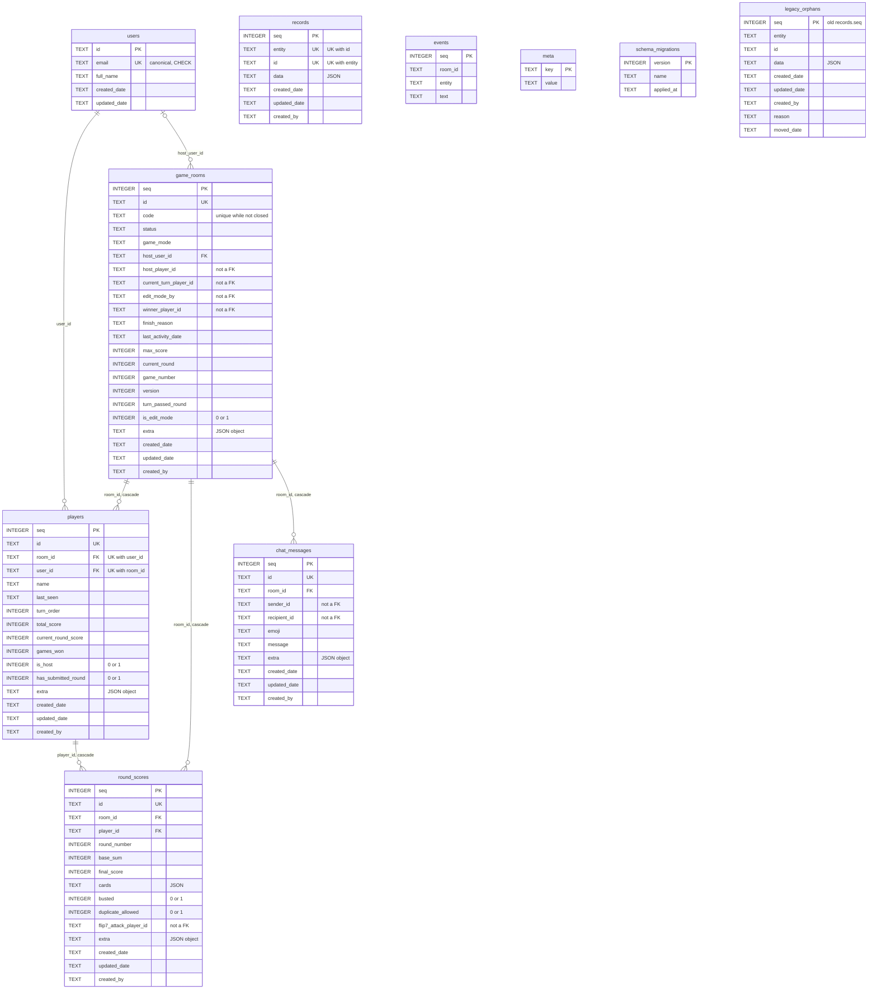
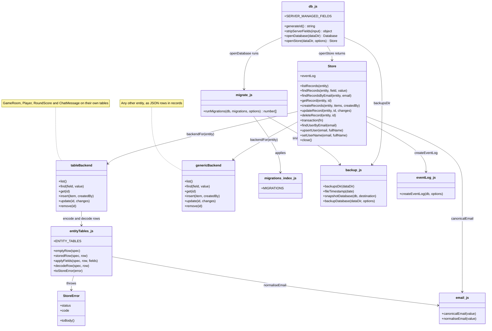
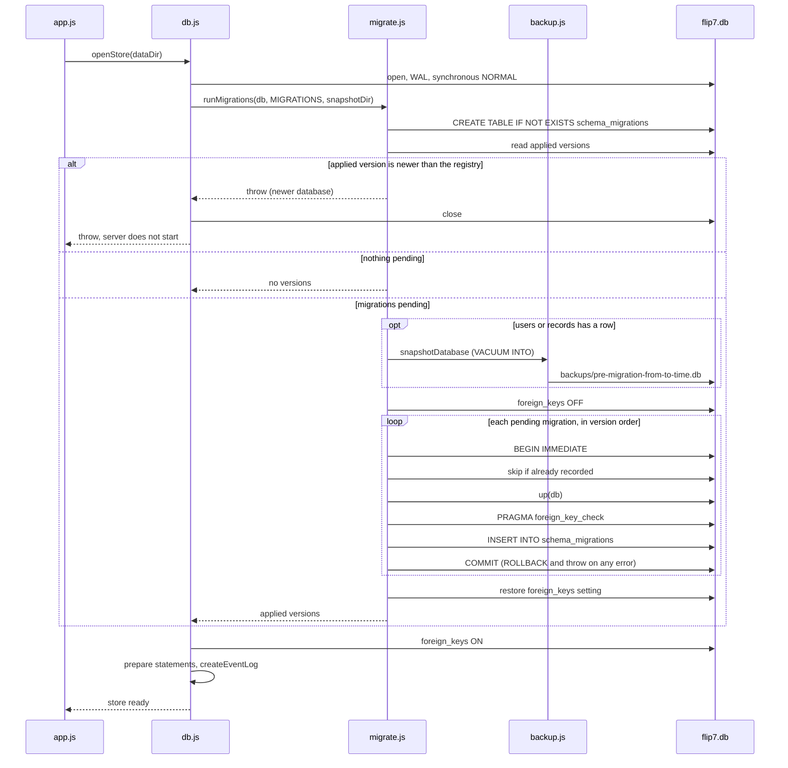
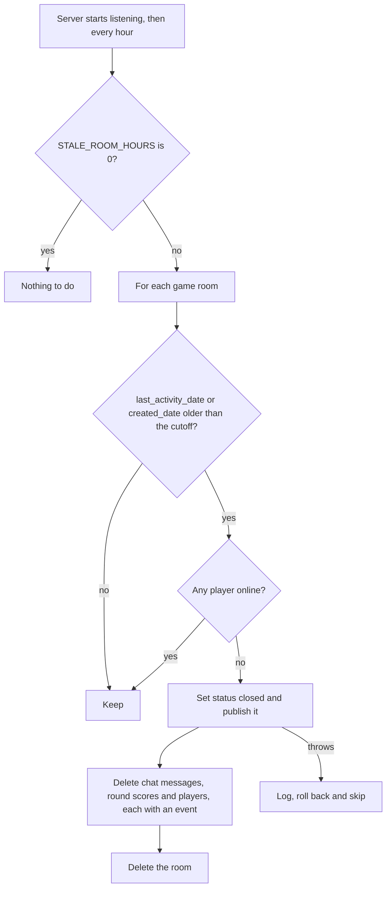

# Database

The server keeps everything in one SQLite file, `DATA_DIR/flip7.db`, opened with
[better-sqlite3](https://github.com/WiseLibs/better-sqlite3) (synchronous, so each request's write is
atomic). This page describes the schema after migration 0004. The source of truth is
`server/src/migrations/`; the behaviour rules are X82-X88 in [decisions.md](decisions.md#server) and
the API side is in [backend-contract.md](backend-contract.md#entities).

## Overview

| Topic | What the code does |
| --- | --- |
| File | `DATA_DIR/flip7.db` (`DATA_DIR` defaults to `server/data`), plus `-wal`/`-shm` while open |
| Journal | `journal_mode = WAL`, `synchronous = NORMAL` |
| Foreign keys | `ON` for the store's connection; `OFF` only while migrations run |
| Schema | Numbered migrations, recorded in `schema_migrations` (see [Migrations](#migrations)) |
| Store API | `openStore()` in `server/src/db.js` keeps the record-shaped API the routes always had (`listRecords`, `findRecords`, `createRecords`, ...), over typed tables for the four game entities and a JSON `records` table for everything else |
| Code | `db.js` (connection, store), `entityTables.js` (table specs, row codec, `StoreError`), `migrate.js` + `migrations/` (schema), `email.js` (canonical emails), `backup.js` (copies), `eventLog.js` (`events`/`meta`), `staleRooms.js` (sweep) |

## Diagrams

### Tables

### Store module

### Server start

### Stale-room sweep

## Table reference

`TEXT` dates are ISO 8601 strings. Every game table also has the common columns below.

### Common columns of the game tables

| Column | Type | Null | Default | Notes |
| --- | --- | --- | --- | --- |
| `seq` | INTEGER | no | autoincrement | Primary key; insertion order for lists and sort ties |
| `id` | TEXT | no | | UNIQUE; 24 hex chars from `generateId()`; the API's id |
| `extra` | TEXT | no | `'{}'` | CHECK `json_valid(extra) AND json_type(extra) = 'object'` |
| `created_date` | TEXT | no | | Server-managed |
| `updated_date` | TEXT | no | | Server-managed |
| `created_by` | TEXT | yes | | Creator's email, a plain string (not a FK) |

### `users` (sign-in accounts; not an API entity)

| Column | Type | Null | Notes |
| --- | --- | --- | --- |
| `id` | TEXT | no | Primary key; never appears in the API |
| `email` | TEXT | no | UNIQUE; CHECK `email <> '' AND email = lower(trim(email))` |
| `full_name` | TEXT | yes | Null for a bare user created when someone is seated before signing in |
| `created_date`, `updated_date` | TEXT | no | |

### `game_rooms` (entity `GameRoom`)

| Columns | Type | Notes |
| --- | --- | --- |
| `code`, `status`, `game_mode`, `finish_reason`, `last_activity_date` | TEXT | |
| `host_user_id` | TEXT | FK `users(id)`, nullable; surfaces as `host_email` |
| `host_player_id`, `current_turn_player_id`, `edit_mode_by`, `winner_player_id` | TEXT | Player ids, not FKs |
| `max_score`, `current_round`, `game_number`, `version`, `turn_passed_round` | INTEGER | |
| `is_edit_mode` | INTEGER | CHECK in (0, 1) |

Indexes: `game_rooms_code (code)`; `game_rooms_open_code`, a partial UNIQUE index on `code WHERE
status IS NOT 'closed'` (a room with no status counts as open; NULL codes never collide).

### `players` (entity `Player`)

| Columns | Type | Notes |
| --- | --- | --- |
| `room_id` | TEXT | NOT NULL, FK `game_rooms(id)` ON DELETE CASCADE |
| `user_id` | TEXT | NOT NULL, FK `users(id)`; surfaces as `email` |
| `name`, `last_seen` | TEXT | |
| `turn_order`, `total_score`, `current_round_score`, `games_won` | INTEGER | |
| `is_host`, `has_submitted_round` | INTEGER | CHECK in (0, 1) |

Indexes: `players_room_user`, UNIQUE `(room_id, user_id)` (one player per user per room; also serves
finds by `room_id`); `players_user (user_id)`.

### `round_scores` (entity `RoundScore`)

| Columns | Type | Notes |
| --- | --- | --- |
| `room_id` | TEXT | NOT NULL, FK `game_rooms(id)` ON DELETE CASCADE |
| `player_id` | TEXT | NOT NULL, FK `players(id)` ON DELETE CASCADE |
| `round_number`, `base_sum`, `final_score` | INTEGER | |
| `cards` | TEXT | JSON; CHECK `cards IS NULL OR json_valid(cards)` |
| `busted`, `duplicate_allowed` | INTEGER | CHECK in (0, 1) |
| `flip7_attack_player_id` | TEXT | Player id, not a FK |

Indexes: `round_scores_room (room_id)`, `round_scores_player (player_id)`.

### `chat_messages` (entity `ChatMessage`)

| Columns | Type | Notes |
| --- | --- | --- |
| `room_id` | TEXT | NOT NULL, FK `game_rooms(id)` ON DELETE CASCADE |
| `sender_id`, `recipient_id` | TEXT | Player ids, not FKs |
| `emoji`, `message` | TEXT | |

Index: `chat_messages_room (room_id)`.

The room's player pointers, `flip7_attack_player_id` and chat's sender/recipient are deliberately not
foreign keys: the game code keeps them current, and chat outlives the players who sent it (X84).

### Other tables

| Table | Columns | Constraints and indexes | Used by |
| --- | --- | --- | --- |
| `records` | `seq` INTEGER PK autoincrement, `entity`, `id`, `data` (JSON) TEXT NOT NULL, `created_date`, `updated_date` NOT NULL, `created_by` | UNIQUE `records_entity_id (entity, id)`; `records_room_id (entity, json_extract(data, '$.room_id'))` | Entities added through `ENTITIES` (not the four game entities) |
| `events` | `seq` INTEGER PK, `room_id` TEXT, `entity` TEXT NOT NULL, `text` TEXT NOT NULL | | Realtime replay log (`eventLog.js`), trimmed to the newest 5000 |
| `meta` | `key` TEXT PK, `value` TEXT NOT NULL | | `epoch` for the event log |
| `schema_migrations` | `version` INTEGER PK, `name` TEXT NOT NULL, `applied_at` TEXT NOT NULL | | Migration runner |
| `legacy_orphans` | the old `records` columns, `seq` as PK, plus `reason` and `moved_date` TEXT NOT NULL | | Rows 0004 couldn't move; `reason` is `missing_room`, `missing_player`, `no_user` or `duplicate_member` (X87) |

The `records_room_id` expression index is only used when a query spells
`json_extract(data, '$.room_id')` exactly; a find on any other field is an unindexed scan.

## How records map to rows

`entityTables.js` holds one spec per game entity (`table`, `columns` with a kind, `userRef`) and the
pure codec; `db.js` runs the SQL. Records keep the shape they had as JSON rows (X83).

| Concern | Rule |
| --- | --- |
| Declared fields | One column each, same name. Kinds: `text`, `number`, `boolean` (0/1), `json` (text). Always present on read, `null` when unset |
| Other fields | Stored in `extra` and merged back into the record on read |
| Writing a declared field | Value must match its kind or the write is a 400; NaN/Infinity store as `null`. Writing it also removes any same-named key from `extra` |
| Updates | Shallow merge: only fields in the change are checked; `undefined` clears a field |
| `email` / `host_email` | Not stored. A write resolves the email to `users.id` (creating a bare user if needed) and a read joins it back, so it is always canonical. `user_id`/`host_user_id` in input are ignored |
| Server-managed | `id`, `created_date`, `updated_date`, `created_by` from input are discarded; on read they win over anything in `extra` |
| Order | Lists and finds are `ORDER BY seq` |
| Finds | User reference field: join on canonical email. Declared field or `id`: one prepared `WHERE` per column. Anything else: JS filter over the list |
| Transactions | `createRecords` (whole batch) and `updateRecord` run in a transaction, so a user created for them rolls back too |
| Deletes | Cascade through the foreign keys; cascaded rows publish no events |

Constraint errors become a `StoreError` ([backend-contract.md](backend-contract.md#entities)):

| SQLite error | HTTP | `code` |
| --- | --- | --- |
| `SQLITE_CONSTRAINT_UNIQUE` (second player for a user in a room, second open room with a code) | 409 | `conflict` |
| `NOT NULL`, `FOREIGN KEY`, `CHECK`, wrong kind, bad email | 400 | `invalid_record` |

The generic `records` backend stores the whole client record (minus server-managed fields) in `data`
and does no type checks.

## Emails

| | |
| --- | --- |
| Canonical form | `value.trim().toLowerCase()` (`canonicalEmail` in `server/src/email.js`); `normaliseEmail` also requires something `@` something, at most 254 chars |
| Enforced by | The CHECK on `users.email`, which only folds ASCII, so the shared normaliser is the real rule; every store user function and the user reference fields canonicalise first; `findRecordsByEmail` on `records` matches in JS with `canonicalEmail` |
| Existing data | Migration 0002 rewrote `Player.email`, `GameRoom.host_email` and every `created_by` |
| Case duplicates | 0002 merged users that differ only by case or spaces: the oldest (`created_date`, then rowid) survives and keeps its name, or takes the first name in its group; blank emails were dropped. A second player the merged user had in one room went to `legacy_orphans` as `duplicate_member` in 0004 |

## Migrations

| Migration | Does |
| --- | --- |
| `0001_baseline` | The pre-migration schema (`records`, `users`, `events`, `meta`), `IF NOT EXISTS` |
| `0002_normalise_emails` | Canonical emails, user merge, rebuilds `users` with the CHECK |
| `0003_game_tables` | Creates the four empty game tables |
| `0004_move_legacy_records` | Moves game rows from `records` into them, creates `legacy_orphans`, drops `records_email` and `records_code` |

How the runner (`server/src/migrate.js`) behaves:

- Each pending migration runs once, in version order, in its own `BEGIN IMMEDIATE` transaction that
  also inserts its `schema_migrations` row, so a failure leaves neither a half change nor a record.
  The later ones don't run. A version already recorded by another process is skipped.
- Foreign keys are off while migrating (table rebuilds would trip them); `PRAGMA foreign_key_check`
  must come back empty before each commit.
- A database whose highest applied version is above the highest in the registry stops startup with
  an error: update the server or restore a backup.
- Before running anything, if `users` or `records` has a row, the database is copied with
  `VACUUM INTO` to `DATA_DIR/backups/pre-migration-<from>-to-<to>-<time>.db`.

To add a migration:

1. Create `server/src/migrations/NNNN_name.js` (next four-digit number) exporting `up(db)`.
2. Keep it self-contained: no imports from `server/src/`; copy any spec it needs and freeze it.
3. Register it in `migrations/index.js` (`migrate.test.js` fails if the folder and list differ).
4. If it changes a game table, update the spec in `entityTables.js` to match.
5. Never edit a migration that has shipped; add a new one.
6. Test it on a legacy fixture first ([testing.md](testing.md)), and record the decision in
   [decisions.md](decisions.md).

## Backups and retention

| What | Where | When |
| --- | --- | --- |
| `npm run backup` (root or `server/`) | `DATA_DIR/backups/flip7-<time>.db` | By hand; SQLite online backup, safe while the server runs and includes the WAL (X88) |
| Pre-migration snapshot | `DATA_DIR/backups/pre-migration-<from>-to-<to>-<time>.db` | Automatically, before pending migrations on a database with data (X82) |
| Stale-room sweep | Deletes rooms and their children, as the host's `delete` action does | At start and hourly; rooms idle longer than `STALE_ROOM_HOURS` (default 24, `0` = off) with nobody online (X81) |

Nothing prunes `backups/`; old copies stay until someone deletes them. `<time>` is the ISO time with
`:` and `.` replaced by `-`. Restoring a copy is in the [README](../README.md#backups-and-upgrades).
The `events` table trims itself to the newest events; nothing else expires.
